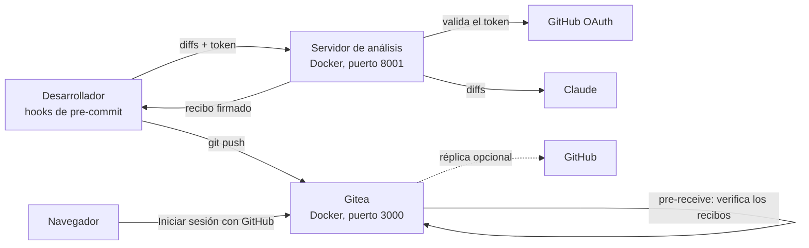

# Alternativa: servidor Git propio con Gitea

En la solución principal el repositorio vive en GitHub.com, que no permite ejecutar lógica propia mientras recibe un push: un commit hecho con `--no-verify` puede llegar a una rama y la GitHub Action solo impide que entre a `main`. En esta alternativa el repositorio vive en un servidor Gitea que corre en Docker, con `verifier/pre_receive.py` como hook `pre-receive`. El servidor rechaza el push de cualquier commit sin un recibo válido, en cualquier rama, y el código nunca queda en el remoto.

## Arquitectura



| Componente | Dónde corre | Cambio frente a la solución principal |
|---|---|---|
| Hooks del cliente | Máquina del desarrollador | Ninguno |
| Servidor de análisis | Contenedor `appsec-analizador` | Es el mismo código, empaquetado en Docker |
| Gitea 1.24.7 | Contenedor `appsec-gitea` | Reemplaza a GitHub como repositorio principal |
| Verificador | Dentro de Gitea, como hook `pre-receive` | Antes corría en GitHub Actions, después del push |
| GitHub | GitHub.com | Solo identidad (OAuth) y, si se configura, una copia de solo lectura |

### Identidad con OAuth 2.0

Una sola OAuth App de GitHub cubre los dos usos:

- **Análisis**: el cliente obtiene el token con el Device Flow (`python hooks/login.py`), igual que en la solución principal. El Device Flow no usa la URL de callback.
- **Gitea**: el login web usa la misma OAuth App con la URL de callback `http://localhost:3000/user/oauth2/github/callback`. Las cuentas solo se crean iniciando sesión con GitHub y reciben el mismo nombre de usuario.

Como los dos nombres coinciden, el hook compara el usuario del recibo (`sub`) con el usuario autenticado que hace el push (`GITEA_PUSHER_NAME`). Un desarrollador no puede subir un commit con el recibo de otra persona.

### Qué verifica el hook

Para cada rama del push, el hook revisa todos los commits que se incorporan a ella:

1. **Integridad**: cada commit debe tener un recibo válido, o ser un merge sin contenido propio. Se aplica también a los commits que ya existen en otra referencia del servidor, como los de un pull request desde un fork.
2. **Identidad**: los commits que el servidor recibe por primera vez deben tener un recibo del usuario que hace el push. Los que ya estaban en el servidor no lo exigen: así otra persona puede integrar un pull request desde la web.
3. **Filtros**: se leen de la configuración ya aceptada en el servidor, no de la del push.

Si un commit falla, ninguna rama del push se actualiza.

### Secretos

- La llave privada de firma solo se monta en el contenedor de análisis, de solo lectura.
- Gitea recibe solo la llave pública y el verificador, ambos de solo lectura.
- `.dockerignore` deja fuera de las imágenes el `.env`, `keys/` y `data/`.
- La contraseña del administrador de Gitea se genera al azar y se guarda en `data/gitea-administrador.txt`, fuera del control de versiones.

## Instalación

### Requisitos

Los de la solución principal (Python 3.12, Git, una cuenta de GitHub y una API key de Anthropic) y además Docker con Docker Compose.

### Pasos

1. Seguir la [instalación](../README.md#instalación) del README: clonar, crear el entorno virtual e instalar `requirements-dev.txt`.

2. Crear una OAuth App en <https://github.com/settings/applications/new>:
   - Homepage URL: `http://localhost:3000`
   - Authorization callback URL: `http://localhost:3000/user/oauth2/github/callback`
   - Marcar **Enable Device Flow**.
   - Copiar el Client ID y generar un client secret.

3. Copiar `.env.example` como `.env` y completar los valores como en la [solución principal](../README.md#servidor-de-análisis), con un cambio: el servidor de análisis queda en el puerto 8001.

```
APPSEC_SERVER_URL=http://127.0.0.1:8001
```

4. Generar el par de llaves de firma:

```bash
python scripts/generar_llaves.py
```

5. Construir e iniciar los dos contenedores:

```bash
docker compose up -d --build
```

6. Configurar Gitea: administrador, login con GitHub, organización `appsec`, repositorio `proyecto` con el contenido actual, hook, solo merge commits y `main` protegida. Se puede ejecutar de nuevo sin efectos duplicados.

```bash
python scripts/configurar_gitea.py
```

7. Cada desarrollador:
   1. Entra a <http://localhost:3000> con **Iniciar sesión con GitHub**.
   2. Recibe permiso de escritura (lo ejecuta quien administra):

      ```bash
      python scripts/configurar_gitea.py --autorizar <usuario de GitHub>
      ```

   3. Crea un token de acceso en Gitea, en *Configuración → Aplicaciones*, con permiso de lectura y escritura sobre repositorios. Es la contraseña para `git push`.
   4. Instala los hooks e inicia sesión para el análisis:

      ```bash
      pre-commit install
      python hooks/login.py
      ```

   5. Agrega el remoto de Gitea:

      ```bash
      git remote add gitea http://localhost:3000/appsec/proyecto.git
      ```

### Réplica opcional a GitHub

Con `GITHUB_ESPEJO_URL` y `GITHUB_ESPEJO_TOKEN` en el `.env`, `configurar_gitea.py` configura una réplica automática: cada push aceptado en Gitea se copia a ese repositorio de GitHub. El token debe tener permiso de escritura solo sobre ese repositorio.

## Uso

El commit funciona igual que en la solución principal. La diferencia está en el push:

```bash
git push gitea mi-rama
```

Un commit hecho con `--no-verify` se rechaza en el servidor (salida recortada):

```
remote: FALLA  3f2a91c0  el commit no tiene recibo de análisis  (Sin analisis)
remote: Push rechazado: 1 commit(s) sin un recibo de integridad válido.
 ! [remote rejected] mi-rama -> mi-rama (pre-receive hook declined)
```

Para corregirlo, se rehace el commit pasando por el análisis:

```bash
git reset --soft HEAD~1
git commit -m "Mismo mensaje"
```

Los pull requests se crean y se integran desde la web de Gitea con el botón **Merge**.

## Pruebas

`tests/test_gitea.py` ejecuta los casos contra el Gitea de Docker Compose. Crea un repositorio y dos usuarios temporales y los elimina al terminar:

```bash
RUN_GITEA_TESTS=1 pytest tests/test_gitea.py
```

En PowerShell: `$env:RUN_GITEA_TESTS = "1"` antes de ejecutar `pytest`.

| Caso | Resultado |
|---|---|
| Push de un commit sin recibo (`--no-verify`) | Rechazado |
| Push de un commit con recibo propio | Aceptado |
| Push de un commit con el recibo de otra persona | Rechazado |
| Merge desde la web hecho por otra persona | Aceptado |
| Squash merge | No permitido |
| Commit creado desde el editor web | Rechazado |
| Pull request desde un fork con commits sin recibo | No se puede crear: los commits nunca llegan al repositorio |

`tests/test_pre_receive.py` cubre la misma lógica con un repositorio Git local, sin Docker, y corre con el resto de las pruebas.

## Comparación con la solución principal

| Aspecto | GitHub con Actions | Gitea con `pre-receive` |
|---|---|---|
| Commit sin recibo en una rama | Llega al remoto; no puede entrar a `main` | Rechazado en el push, en cualquier rama |
| Recibo de otra persona | No se compara con quien sube el commit | Rechazado |
| Infraestructura | Ninguna adicional | Docker con dos contenedores |
| Configuración del repositorio | Manual en la web de GitHub (ruleset, variable, merge) | Automática con `configurar_gitea.py` |
| Disponibilidad para un evaluador | Repositorio público en GitHub | Se levanta localmente con Docker |
| Evidencia pública | PRs y ejecuciones de la Action | Pruebas automáticas y capturas |

## Limitaciones

- Gitea corre en `localhost` y sin HTTPS. Para un equipo, se desplegaría en un servidor con HTTPS, un dominio propio y la URL de callback de la OAuth App ajustada.
- Quien administra Gitea puede quitar el hook o subir commits por fuera del control: es parte de la base de confianza, igual que quien administra el repositorio en GitHub.
- El hook se instala por repositorio. Un repositorio nuevo necesita `configurar_gitea.py` o la instalación manual del hook.
- El contenido inicial se sube antes de activar el hook, porque sus commits no tienen recibos.
- Cuando un pull request desde un fork se rechaza, Gitea muestra un error genérico (500) en lugar del mensaje del hook. El motivo queda en el registro del contenedor (`docker logs appsec-gitea`).
- Cada contenedor guarda sus datos en un volumen de Docker. `docker compose down -v` los elimina.
